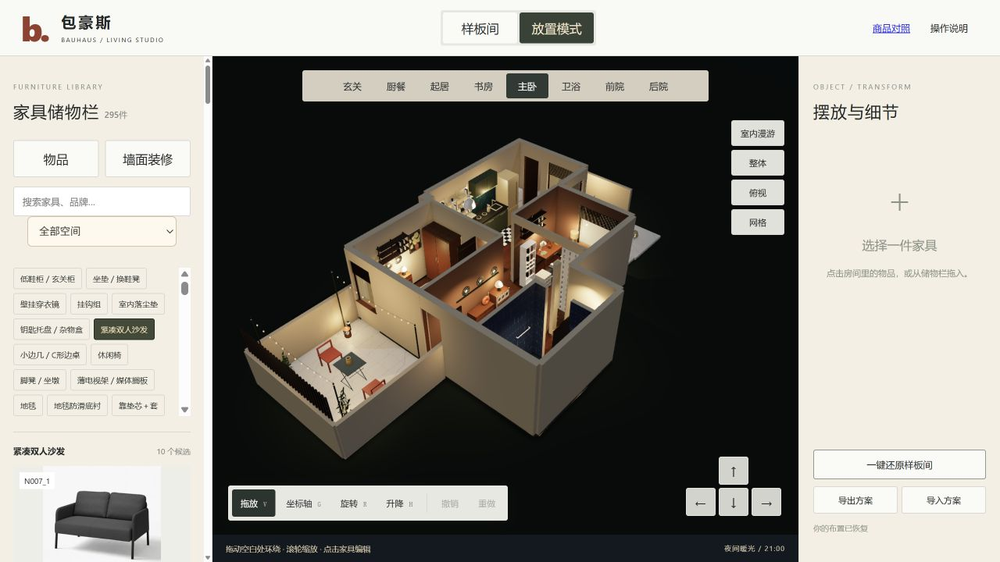
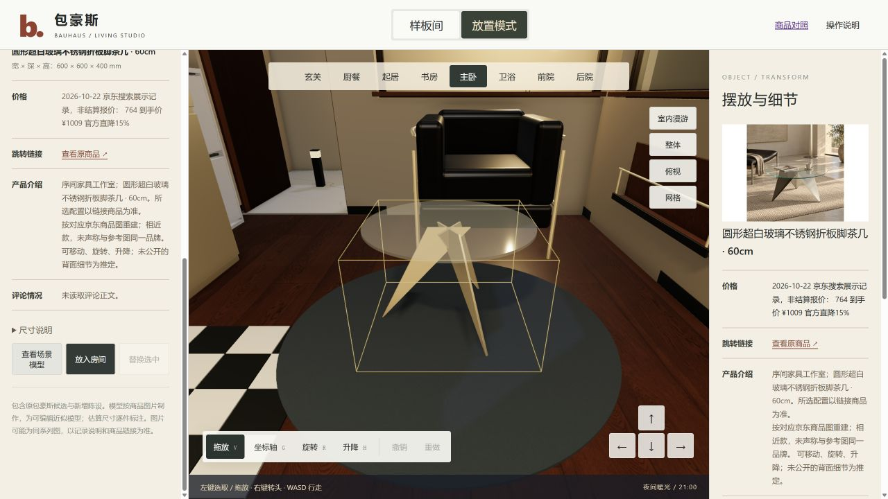
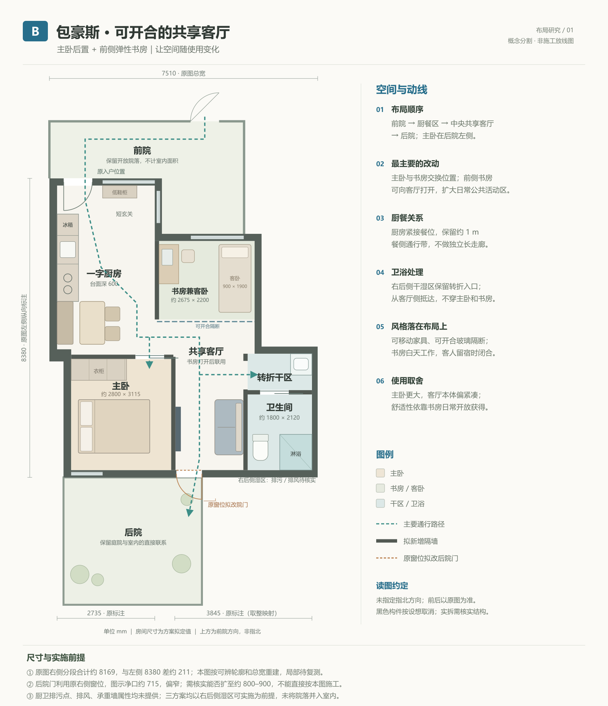
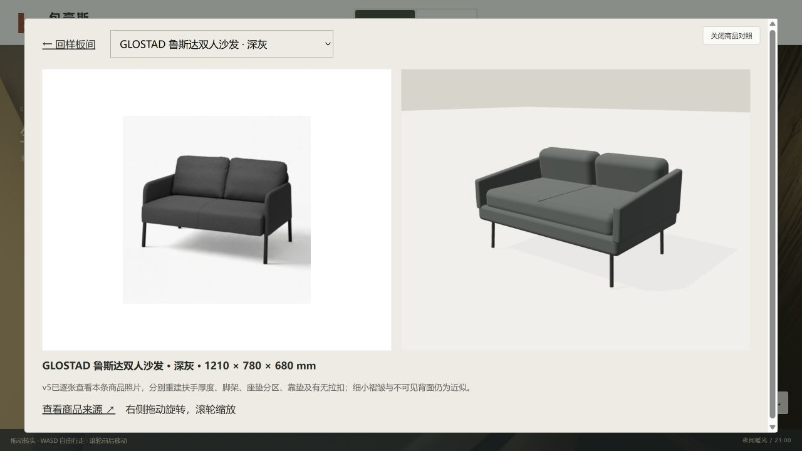
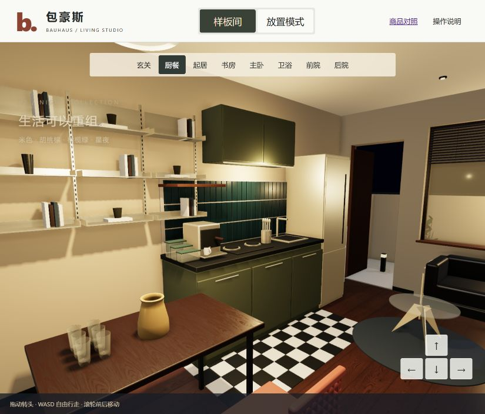
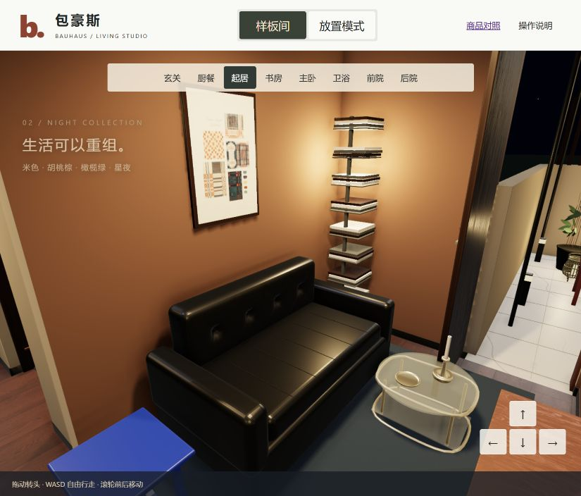
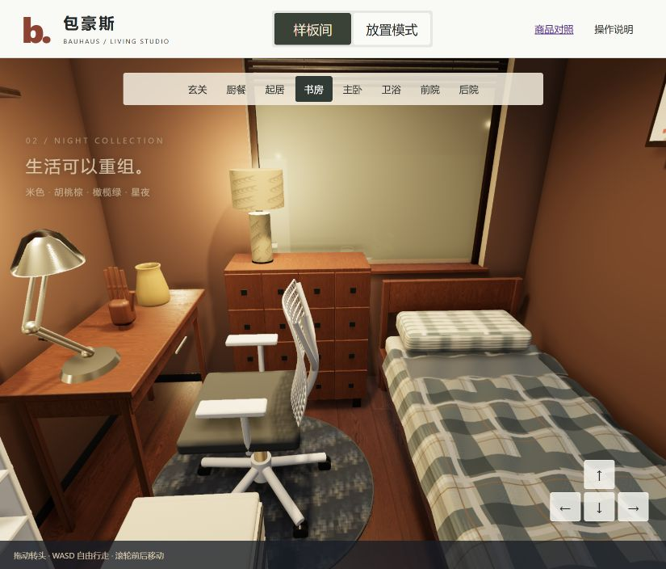
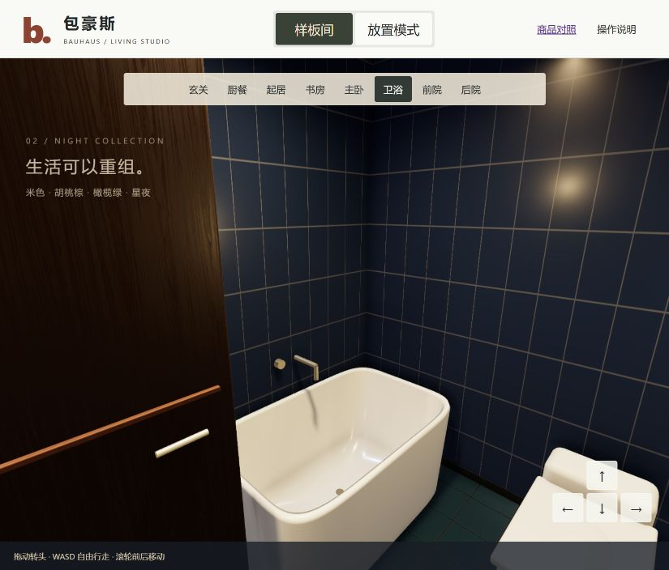

# Bauhaus Living Studio · 包豪斯可玩样板间

用 Three.js 制作的一套夜景住宅样板间：可以自由走动，也可以从商品库放入家具、移动、旋转、升降和更换整间墙色。样板间与放置模式使用同一套实时材质和灯光。

这个仓库整理自已经制作并迭代的本地网页，保留现有户型、窗户位置和包豪斯方案 B。包含 **295 件商品候选、80 个默认摆放实例、3 个墙面涂料候选**。商品库中的候选可逐件放入，默认样板间并非把 295 件商品同时堆进房子。

**交付内容：** 可直接打开的 `standalone.html`、可部署的 `dist/`、可编辑源码、商品数据与图片、两套可复用 skill、制作流程、检查脚本与插图。



*当前打包版本的整体视角；左右为家具库和编辑属性面板。*

> 这是实时设计方案模型，不是 Blender 离线路径追踪画面，也不是厂商 CAD。商品模型包含依据图片推定的细节，尺寸是否暂定见每件商品说明。价格与评论是历史采集记录，不会自动更新。图片是本项目实际界面或制作过程记录。

## 1. 先打开成品

### 方法 A：单个 HTML，最简单

1. 解压完整交付包。
2. 用桌面版 Chrome 或 Edge 打开根目录的 **`standalone.html`**。
3. 等待第一次解码内嵌纹理与图片；进入后可直接行走和摆放，无需切换“开始渲染”。
4. 文件已经内嵌 JS、CSS、Three.js、商品 JSON、材质与商品图片；移动这一份 HTML 即可带走场景。
5. “商品对照”在当前页面打开内嵌对照窗口，关闭后回到场景；无需另外携带对照页文件。
6. 商品购买链接仍会访问原网站；离线时场景能打开，原商品网站不能离线浏览。

单文件比多文件版大，第一次打开需要解码，不能承诺零等待。推荐桌面浏览器、硬件加速和 WebGL2。浏览器对 `file://` 的本地存储行为可能不同，重要摆放请使用“导出方案”。

### 方法 B：已构建多文件版

安装 Node.js 20 或更高版本后，在本目录打开终端：

```sh
node scripts/serve.mjs
```

打开 `http://127.0.0.1:18769/`。Windows 也可双击 `start.cmd`。默认端口为 **18769**，与原来 8769 的页面分开。停止服务用 `Ctrl+C`。预构建版不需要先装 npm 依赖。

若端口被占用：

```sh
node scripts/serve.mjs dist 18770
```

### 方法 C：从源码重新构建

```sh
npm ci
npm run check
npm run build
npm start
```

Windows PowerShell 若禁止执行 `npm.ps1`，可改用 `npm.cmd ci`、`npm.cmd run build` 等。不要为此修改系统执行策略。

`npm run build` 同时更新 `dist/` 和 `standalone.html`。只修改源码、不重新构建，已交付的 HTML 不会随之变化。`dist/` 的 `index.html` 需要通过 HTTP 服务打开；直接双击请使用 `standalone.html`。

## 2. 操作说明

| 操作 | 方法 |
| --- | --- |
| 切换空间 | 顶部玄关、厨餐、起居、书房、主卧、卫浴、前院、后院 |
| 样板间漫游 | 鼠标拖动转头，W/A/S/D 或屏幕方向键移动，滚轮前后移动 |
| 进入编辑 | 点击“放置模式” |
| 加入物品 | 左侧按房间、类别或品牌筛选；拖商品图进场景，或点“放入房间” |
| 查看商品 | 选中模型，右侧显示图片、尺寸及独立的价格／跳转链接／产品介绍／评论情况 |
| 移动模型 | V 拖放；G 坐标轴；R 旋转；H 升降，也可输入 X/Y/Z 和角度 |
| 编辑时转头 | 室内漫游状态下右键拖动；整体视角拖动空白处环绕 |
| 复制／删除 | 右侧“复制”“移回储物栏”；Delete 收回选中家具 |
| 撤销／重做 | 底部工具栏；Ctrl+Z／Ctrl+Shift+Z |
| 改墙面 | 左侧“墙面装修”，选房间和颜色；拖色卡到墙上或点“整间应用” |
| 开关门 | 靠近门后点击门扇 |
| 保存／迁移 | 编辑自动保存在当前浏览器；“导出方案”保存 JSON，“导入方案”恢复 |

“样板间”显示预设布置，“放置模式”恢复你的编辑状态；切换不会删除编辑保存。“一键还原样板间”会替换编辑布局，可立即撤销。方案 JSON 包含家具位置、旋转和房间颜色，不打包新的商品定义或照片。



*图 1：商品信息分为价格、跳转链接、产品介绍、评论情况；右侧尺寸和坐标用于摆放。*

## 3. 从规划到成品的详细制作步骤

下面对应这次制作的实际工作链。保留的源码和最终数据可复现当前成品；早期临时脚本、登录会话及聊天文件不是运行依赖。

### 步骤 1：整理户型边界，锁定不能修改的位置

1. 先读取原平面图，把尺寸换成米；例如 7510 mm 写成 `7.51`。
2. 把外轮廓、承重／固定墙段、门洞、窗洞分别记录，区分实测尺寸与方案概念尺寸。
3. 本项目采用方案 B：主卧后置、书房兼客卧、共享客厅，保留前后院连接。
4. 在 `public/data.json` 的 `layout` 中维护 `walls`、`windows`、`doors`、`floor`。
5. 用户要求不改房间和窗位时，先保存这四组数组；改家具之后逐项比对。不要为了容纳大床而悄悄扩大房间。
6. 记录固定厨卫设施及门扇开启范围，再安排行走路线。当前方案图是概念依据，不能用截图像素直接推算施工尺寸。

原先的平面方案绘制脚本也已收录。可用 Python 3（仅标准库）执行：

```sh
python scripts/draw-plans.py
```

它会在 `docs/plans/` 重新生成 A/B/C 三种原始方案的 SVG 和可切换的 HTML，供比较规划思路。当前互动样板间使用 B 方案；这个历史规划脚本不反向修改 Three.js 场景。README 的 PNG 是已附带的预览图。



*图 2：早期方案 B 的空间规划图，用来说明分区与动线；后续家具位置以当前场景数据为准。*

### 步骤 2：建立房间风格与选品任务

1. 把总风格拆成房间任务：米色公共墙、胡桃木、橄榄绿、深蓝卫浴、金属框架和夜间暖光。
2. 为每个空间记录需要的家具、尺寸上限、预算、挂墙／落地／台面摆放方式。
3. 区分“样板间默认选中款”与“可以在放置模式中玩的候选款”；同类沙发不会全部堆进客厅。
4. 墙色按整个房间更新，湿区砖缝保留；图中的颜色是设计预览，不能当作涂料厂商的真实色号。
5. 使用仓库内的 [`room-planning` skill](skills/room-planning/SKILL.md) 整理规划和可验收的布局约束。

### 步骤 3：先搜商品、查看图片，再建模

1. 先查已有清单，避免把同一商品重复录入。
2. 没有匹配款时，用“品类＋造型特征＋材质＋尺寸”搜索。例如“黑色皮艺 钢管 扶手椅 82cm”“不锈钢 轨道 壁挂 书架”。
3. 优先读取用户指定平台的真实商品页；本次补充主要来自京东。搜索结果不是同款证明。
4. 打开图片，看扶手、脚架、靠垫分区、开孔、金属件、材质与配色；同系列不同规格也要区分。
5. 记录 SKU、原链接、店铺、价格日期、规格、原图来源、评论证据和未核实部分。
6. 没有读到买家评论时写“未读取评论正文”，不能把销量、“种草”数量或宣传语当作口碑结论。
7. 验证页由用户手动完成，不在脚本里保存账号、Cookie、验证码或自动绕过验证。
8. 使用 [`product-research` skill](skills/product-research/SKILL.md)；历史选品示例在 `docs/research/`，不是今天重新查到的报价。

### 步骤 4：整理商品数据，统一尺寸语义

1. 在 `public/products/` 放入本地商品图，用稳定的 `sourceKey` 或 SKU 命名。
2. 在 `public/data.json` 的 `catalog` 增加商品，字段示例见 [数据格式说明](docs/DATA_FORMAT.md)。
3. `dims` 固定为 **[宽、深、高]，单位米**；显示时乘 1000 转成毫米。
4. 成品尺寸、展开尺寸、折叠尺寸、组合尺寸、场景模型包络不能混用。
5. 例如：毛巾不能把 70×140 cm 的展开尺寸当成叠好后的宽深；床品模型的下垂高度也不是被套规格。
6. 尺寸未核实则 `estimated: true`，并在 `sizeText` 写清暂定的是哪一维。不要把推测写成厂商参数。
7. 本版保留 `price`、`url`、`brandIntro`／`modelNote`、`review`，界面分别展示为四栏。

### 步骤 5：按照片做可移动模型

1. `src/objects.js` 是模型入口 `product(p, M)`，根据商品种类和专用标记路由。
2. `photo-models-v5.js` 包含本轮按图修正的沙发、黑皮钢管单椅、格纹床品、浴缸、金属壁架、镂空隔断和玻璃茶几等。
3. `photo-models-v4.js`、`hero-models.js`、`accessories.js` 保留此前建立的家具和摆件分支。
4. 每件家具先拆成座垫、靠背、扶手、支架等有辨识度的部分，再建网格；不要用一个通用方块换颜色代表所有商品。
5. 最终模型归一到目录包络尺寸，底部落在 Y=0。模型最终正面朝 +Z，摆放时通过 `rotation` 改方向。
6. 商品图片用于观察和局部纹理，不是自动单图精确重建；背面、细小褶皱和不可见结构仍可能是近似。
7. 打开 `model-review.html`，对照原图旋转模型，检查整体轮廓、脚架和靠垫数量。这个页面当前聚焦 10 款沙发与 6 个 v5 专用模型，不是全库逐件对照报告。单文件 HTML 内也可通过“商品对照”进入。



*图 3：本次单文件打包后实测的内嵌对照窗口，左边商品原图，右边可旋转网格。*

### 步骤 6：补材质、夜景灯光和接触阴影

1. `src/materials.js` 定义木纹、布料、皮革、金属、玻璃、墙面和石材。
2. 颜色贴图用 sRGB；法线、粗糙度图使用数据色彩空间，不能一律当彩色图读取。
3. 使用 Poly Haven 的本地材质贴图，来源清单在 `public/assets/sources.json`；布纹、地毯和石纹另有程序生成纹理。
4. 金属需要环境反射，不能只把 `metalness` 拉高。场景使用 RoomEnvironment、PMREM、阴影与 GTAO 接触遮蔽。
5. 保留橄榄绿、木色和深蓝墙面的材质差异，降低过强法线造成的“粗糙塑料感”。
6. 夜景仍需可辨认的层次；检查灯罩高光、金属反射、浴室阴影，避免把暗部完全压黑。
7. `src/app.js` 的 `init()` 组织渲染、灯光与后处理；样板和编辑共用同一渲染链。不是加载 Blender 光照结果的导出器。



*图 4：厨餐区的暖光、木材与金属细节。*

### 步骤 7：摆入房间，检查实际通行

1. 在 `layout.placed` 新增实例，引用商品 `pid`，设置 `x/y/z/rotation`。
2. 先放床、沙发、柜体，再放茶几、灯、挂架和小摆件。不要只根据视觉“填满”而堵门。
3. 挂墙物体设置 `mount: "wall"`，台面摆件设置 `mount: "surface"`；检查它们是否有支撑。
4. 夜间初始场景保留 80 个摆放实例，候选库保留全部 295 件。
5. 从入口依次走到书房、卧室、客厅、干区、浴室和两座院子，检查门扇与窗台。
6. 调整家具而不改变锁定的墙窗数据；新浴缸也要检验与通道、洗手台之间的关系。
7. 运行检查脚本并人工看屏幕。包围盒通过不代表模型已经与商品实物完全一致。



*图 5：起居区的黑色皮艺沙发和茶几。*



*图 6：床架与床品分开建模，床品采用蓝灰格纹。*



*图 7：深蓝卫浴和独立浴缸；家具移动后应重新检查通道。*

### 步骤 8：验证，导出多文件和单文件版本

1. `npm run check` 检查数据引用、图片存在性、模型有限坐标与尺寸包络、默认布局重叠、八个路径点及台面支撑。
2. `npm run build` 把模块打包到 `dist/app.js`，把模型对照打包到 `dist/model-review.js`。
3. 构建脚本再把 JS、CSS、JSON、图片和纹理内嵌成 `standalone.html`，单文件内部仍是可交互 3D 页面。
4. 浏览器分别打开多文件版和单文件版，测试漫游、切换模式、加入家具、坐标编辑、撤销、整间改色、导出导入和商品对照。
5. 更换电脑之前导出自己的方案 JSON。源码包中的默认场景不包含当前浏览器里私人修改的 localStorage。
6. 交付验证记录见 [VALIDATION.md](docs/VALIDATION.md)。

## 4. 目录与修改入口

```text
bauhaus-open-source/
├── standalone.html           # 已打包单文件成品（交付包附带）
├── dist/                     # 已构建网站，运行无需安装 npm 依赖
├── public/
│   ├── index.html            # 页面模板
│   ├── style.css             # 界面样式
│   ├── data.json             # 商品、墙体、窗户、门、默认布局
│   ├── products/             # 商品图（第三方参考素材）
│   └── assets/               # 本地材质贴图与来源
├── src/                      # 模型、场景、交互、碰撞及加载适配
├── scripts/                  # 构建、本地服务、数据与模型检查
├── skills/
│   ├── room-planning/        # 户型规划与软装布局 skill
│   └── product-research/     # 商品搜索、图片与规格核对 skill
├── docs/
│   ├── images/               # README 实际插图
│   ├── plans/                # 原始规划 SVG 与方案比较 HTML
│   ├── research/             # v4/v5 新增商品记录
│   ├── DATA_FORMAT.md        # 字段、坐标和实例说明
│   ├── DEVELOPMENT_HISTORY.md # 制作阶段与踩坑记录
│   └── VALIDATION.md         # 验收范围与结果
├── licenses/                 # 依赖许可证
├── LICENSE                   # 原创代码与文档 MIT
└── THIRD_PARTY_NOTICES.md     # 图片、材质与依赖的范围说明
```

| 想改什么 | 修改位置 |
| --- | --- |
| 商品价格、品牌、链接、评论、图片路径 | `public/data.json → catalog` |
| 默认摆放位置 | `public/data.json → layout.placed` |
| 结构尺寸、门洞、窗位 | `public/data.json → layout`；同时核对 `house.js` 与 `collision.js` 的固定设施 |
| 默认墙色／房间分组 | `src/finishes.js` |
| 厨卫固定设施与门扇 | `src/house.js` |
| 沙发或新物品形状 | `src/photo-models-v5.js`，或在 `objects.js` 增加专用分支 |
| 灯光、相机、画质 | `src/app.js` 的 `init()`、`views`、`resize()` |
| 商品信息四栏样式 | `public/style.css` 中 `.product-info` |

布局和部分固定设施为本户型定制，替换成另一套户型需要一起修改房间分组、漫游相机和碰撞设施，不能只替换一张平面图。

## 5. 安装和使用两个 skill

两个 skill 使用通用的 `SKILL.md` 格式，可复制到所用工具配置的技能目录，也可直接作为规划与搜索工作流程文档使用：

```text
skills/room-planning/
skills/product-research/
```

具体安装位置以所用工具的配置为准，复制时保留各 skill 的参考文件。无需安装第三方搜索程序；商品搜索 skill 使用当前环境可用的浏览器或搜索工具，不包含平台账号。

示例提示词：

```text
使用 $room-planning，基于这个仓库规划新的卧室方案。
保持 layout 中房间外轮廓、门洞和窗户不变，先检查净通道，
再输出默认家具实例与需要补齐的选品任务。
```

```text
使用 $product-research，先查当前 catalog 是否已有合适的
黑色皮艺钢管单椅；没有则在京东找三个候选。
打开商品图核对外形，价格、链接、介绍、评论分开记录，
无法确认的尺寸明确标为暂定，别把相似款写成同款。
```

规划 skill 输出空间约束与采购任务；搜索 skill 输出可追溯的商品记录。两者都要求先看图片再建模，并保留未核信息，不保证从单张图自动生成精确模型。

## 6. 部署与开源发布

完整本地包保留商品照片以复现当前页面。**MIT 只覆盖本项目原创代码、程序化模型实现及文档，不转授商家照片、品牌标志或参考作品权利。** 已有来源与未确认项见 [第三方说明](THIRD_PARTY_NOTICES.md)。

需要公开部署、且暂未取得商品图片再分发许可时，可以生成去商品照片版本：

```sh
npm run build:public
```

输出在 `release-public/`，保留模型、材质、商品文字与原链接，以占位图代替商家照片。**这个命令只生成公开版构建文件，不会清除源码里的 `public/products/` 或 README 截图**；创建公开仓库时仍需排除未获授权的商品图及包含这些图的截图。授权完整后可以发布完整素材版。

普通静态部署上传 `dist/` 内容即可，没有后端、数据库、账号服务或跟踪接口。不需要把 `node_modules/` 上传。首次安装开发依赖需要访问 npm；运行成品没有 CDN 依赖。这里只生成文件，未替你创建或推送 GitHub 仓库。

需要重新打包完整交付 ZIP 时，在构建和检查通过后运行 `python scripts/package.py`。它排除 `node_modules` 等开发缓存，包含源码、HTML、预构建网站、skills、图片和文档，并写入 SHA-256 文件清单。

## 7. 常见问题

**打开后黑屏或一直加载：** 使用支持 WebGL2 的桌面浏览器并开启硬件加速；多文件版检查是否经 HTTP 打开。查看控制台是否有纹理或数据 404。单文件请等初次图片解码完成。

**画面卡顿：** 先减少同时摆放的物件。开发者可降低 `renderer.setPixelRatio` 的上限或 GTAO 分辨率；改完重新构建。模型库数量不等于同时渲染数量。当前没有手机性能保证。

**修改数据没有变化：** 重新执行 `npm run build`，刷新新产物；样板间显示默认数据，放置模式可能恢复了本地旧方案，可先导出旧方案再一键还原。

**添加家具后位置提示重叠：** 位置检查是辅助提示；程序不会替你完成所有空间规划。移动家具、调高度或改为合适的挂墙／台面类型，再亲自检查通行与支撑。

**图片相似但模型仍不完全一样：** 目前为手工参数化近似模型，部分商品仍使用类别分支。尺寸包络检查只验证大小，不验证外形。需要在商品对照中继续核查。

**价格或评论不准确：** 它们是制作时记录，不是实时接口。要更新请运行搜索工作流并记录新的核对日期，不要把本次打包日期当成重新采集日期。

**四栏里没有评论内容：** 没读到真实评论时保留“未读取评论正文”。这是数据缺口，不是零差评。

**有些链接指向参考图：** 现有库中 5 件标记为“参考复建·同款待核”，尚无已确认商品页，链接保留参考图片。它们是可摆放的参考模型，不能计为已找到同款。

