# 大肥鱼 · Live2D 虚拟伙伴

把蓝色小鲸鱼变成住在电脑里的虚拟室友。和她打字、语音聊天，让她挥手、动耳朵、摆尾巴，也可以把她放到桌面上，授权她看屏幕，对有趣的画面做简短吐槽。

本项目基于 [AIRI](https://github.com/moeru-ai/airi) 二次开发，提供现成的 Live2D 模型、角色设定、交互功能修改和 Windows 安装脚本。将项目交给 AI 编程 Agent，即可让它执行安装并协助完成首次配置，无需自己从头建模或编写代码。

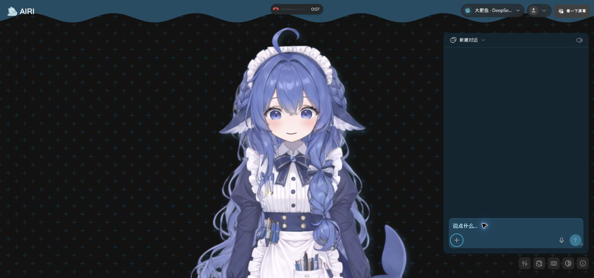

*配置完成后的网页界面。在右侧输入文字即可聊天，角色会通过 TTS 开口回应。*

## 能做什么

| 功能 | 使用方式 |
| --- | --- |
| 文字聊天 | 在聊天框发送消息，使用你配置的大模型回复 |
| 语音对话 | 持续聆听麦克风，将识别结果自动发送，再用 TTS 播放回复 |
| 角色动作 | 说或输入“挥挥手”“抖抖耳朵”“摆摆尾巴” |
| 说话口型 | 根据播放音频的音量控制嘴巴开合 |
| 桌面陪伴 | 以透明桌宠窗口显示角色 |
| 屏幕陪看 | 共享屏幕或窗口，单次识图或持续点评 |
| 可选声线 | 默认中文 Edge TTS，也可配置 GPT-SoVITS 和自己的参考录音 |

“唱歌”目前是文字歌词和哼唱语气，普通 TTS 仍按说话方式播放，不会生成真正的歌声。

## 1. 下载并交给 Agent

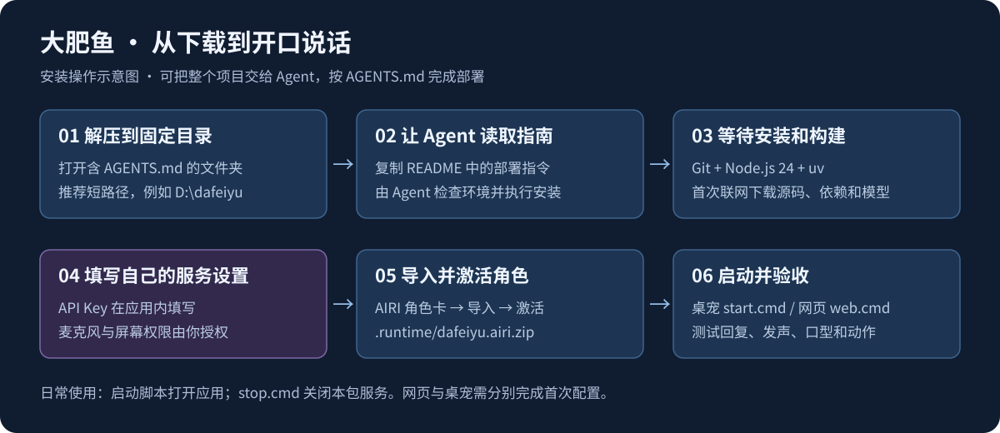

*安装流程示意图。首次配置需要你填写自己的密钥并批准权限，其余步骤可由有相应操作能力的 Agent 协助完成。*

支持 **Windows 10/11 x64**。下载项目 ZIP 并解压，或克隆仓库，放在固定的短路径中，例如 `D:\dafeiyu`。确认目录下能看到 `AGENTS.md` 和 `install.ps1`。

用 Qoder、Codex 或其他能够操作本地文件、运行终端的编程 Agent 打开这个目录，把下面这段话发给它：

```text
读取本项目的 AGENTS.md，检查并安装依赖，完成大肥鱼的本地部署。
默认使用中文 Edge TTS，导入角色卡，配置语音输入和自动发送，并启动桌宠。
需要 API Key 时让我在应用设置里填写；需要麦克风或屏幕权限时让我授权。
最后检查聊天、发声、口型和动作是否正常，不要只给我操作建议。
```

Agent 会按 [AGENTS.md](AGENTS.md) 准备 Git、Node.js 24 和 uv，拉取固定版本的 AIRI，应用本项目修改并构建网页端和桌宠端。若 Agent 不具备浏览器或桌面操作能力，安装后按下文手动完成设置。

首次安装需要联网下载依赖和模型，耗时取决于网络与电脑配置。这是可由 Agent 部署的源码包，不是离线免安装程序。聊天和视觉服务可能产生 API 费用。

已有所需依赖时，也可以在项目目录手动运行：

```powershell
powershell -File install.ps1
```

看到构建完成提示后，再启动应用并完成首次配置。

## 2. 启动并导入大肥鱼

| 文件 | 用途 |
| --- | --- |
| `start.cmd` | 启动桌宠和所需本地服务 |
| `web.cmd` | 启动网页版并打开浏览器 |
| `stop.cmd` | 关闭本包启动的程序和服务 |

网页版地址为 `http://127.0.0.1:5173/`。启动后按顺序操作：

1. 在欢迎页配置自己的聊天服务和模型，例如使用自己的 DeepSeek API Key。密钥直接填入应用设置，不要写进项目文件。
2. 在设置中打开 **AIRI 角色卡**，导入安装后生成的 `.runtime/dafeiyu.airi.zip`。
3. 激活“大肥鱼”角色卡，回到主界面，输入“你好”验证文字回复。

<p align="center">
  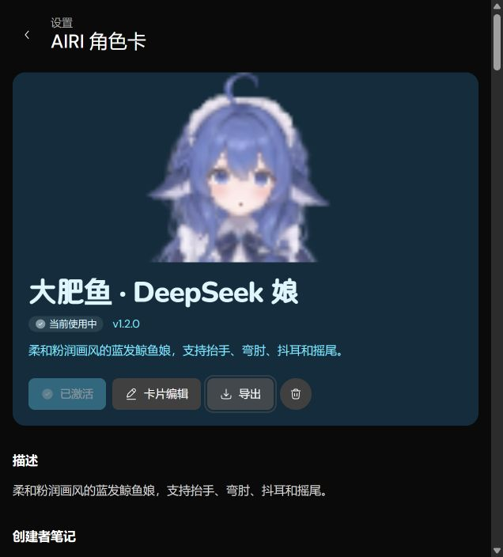
</p>

*导入后打开角色卡，确认出现“当前使用中”或“已激活”。“卡片编辑”可调整性格提示词。*

<p align="center">
  
</p>

*包内已包含模型和角色设定，首次使用无需重新拆图或绑定。*

桌宠与网页分别保存配置。换浏览器、换浏览器用户或切换到桌宠时，需要在对应环境完成导入和服务配置。

在角色卡内还可以检查模型与声音的绑定：

<p align="center">
  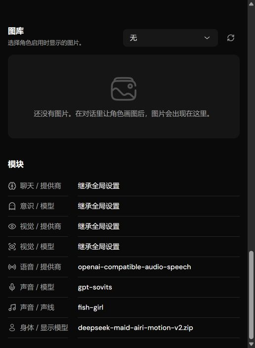
</p>

角色卡下方的“模块”区域可以检查绑定是否正确。聊天和视觉可继承全局设置，“身体 / 显示模型”应指向大肥鱼模型。此图使用可选 GPT-SoVITS 声线，默认安装的声音模型应为 `edge-tts`，具体模型文件名可能不同。

## 3. 让她开口说话

默认安装使用中文 **Edge TTS**，需要联网，不需要另外提供 TTS 云端密钥。

在 **设置 → 服务来源 → 语音合成** 中选择 **OpenAI 兼容 API**，填写：

| 设置项 | 默认值 |
| --- | --- |
| Base URL | `http://127.0.0.1:8008/v1/` |
| API Key | `local-tts` |
| Model | `edge-tts` |
| Voice | `zh-CN-XiaoxiaoNeural` |

这里的 `local-tts` 是本机适配器占位值，不是聊天模型的 API Key。

接着打开 **设置 → 机体模块 → 发声**，开启“发声”，选择刚配置的服务，语速保持 `1`。

<p align="center">
  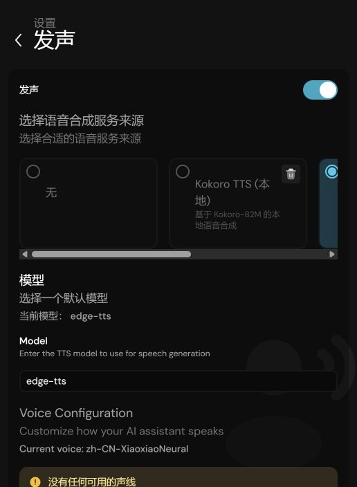
</p>

*图中 Model 为 `edge-tts`，当前声线为 `zh-CN-XiaoxiaoNeural`。若列表没有声线，可手动填写 Voice；以实际合成测试为准。*

回到聊天界面发一句“介绍一下你自己”。应能听到声音，并看到嘴巴随语音开合。播放结束后，嘴巴会恢复闭合。

### 可选：换成 GPT-SoVITS 声线

准备自己有权使用的干净参考人声和对应逐字台词，按 [AGENTS.md](AGENTS.md) 中的“克隆声线”步骤操作。该方案需要额外下载模型、安装 FFmpeg，并填写本地 `voice.local.json`；CPU 推理会比普通 TTS 慢。

本包不分发视频提取音频或个人参考录音。首次使用建议先跑通默认声线，再切换。

<p align="center">
  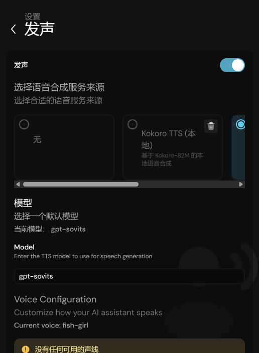
</p>

*安装可选声线后，发声模型改为 `gpt-sovits`，Voice 改为 `fish-girl`，服务地址使用 `http://127.0.0.1:8009/v1/`。仅修改这两个名称不会自动安装语音模型。*

## 4. 开启持续语音聊天

打开 **设置 → 机体模块 → 听觉**：

1. 在“语音识别”中配置本地 Sherpaw / Paraformer 中文识别，等待识别模型下载完成。
2. 启用麦克风，选择实际使用的输入设备，并允许应用访问麦克风。
3. 将“开始聆听”设为 **持续聆听**，打开“聆听”。
4. 打开 **自动发送**，发送延迟设为 `0.5 秒`。可关闭“说完判断”和“转写改写”，减少额外请求。

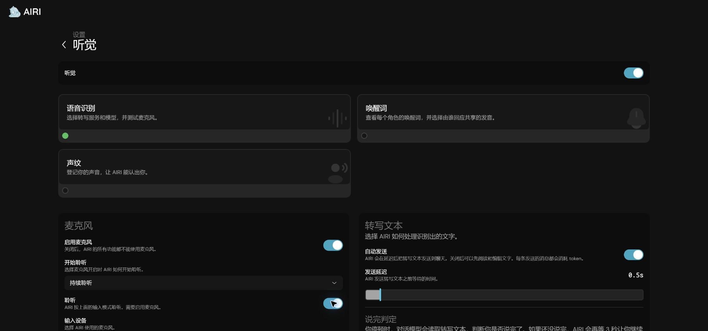

*左侧控制麦克风与持续聆听，右侧控制识别文本是否自动发送。两边都配置好，才能连续对话。*

<p align="center">
  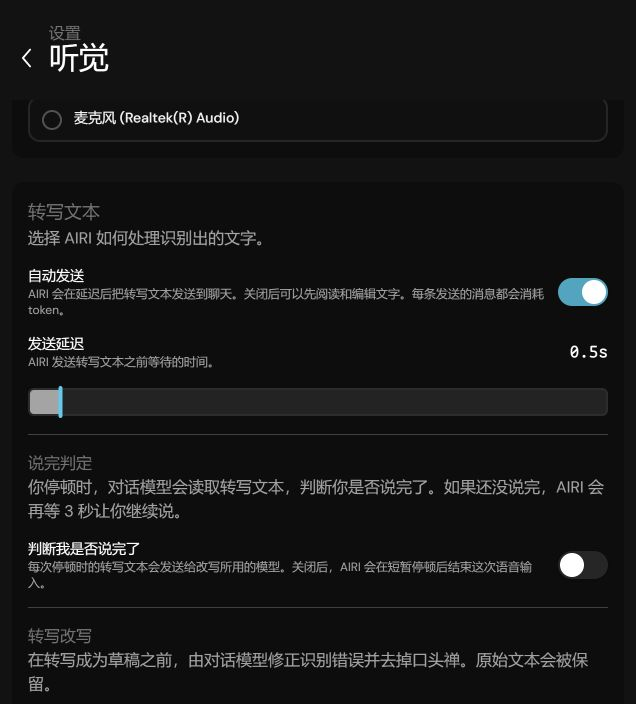
</p>

*自动发送设置近景。识别出文字却不回应时，先检查这里；设备名称按自己的麦克风选择，无需与图中一致。*

说一句“大肥鱼，你听得到我吗”，停顿后，识别文本应自动发送并得到语音回应。不要同时在网页和桌宠中开启持续聆听，以免重复收音；使用耳机也能减少扬声器回声。

## 5. 让她做动作

在聊天框输入，或直接对她说：

```text
挥挥手
抖抖耳朵
摆摆尾巴
```

角色卡包含动作触发规则，前端会解析对应动作指令并播放模型动画。需要使用本包导出的角色卡和模型；仅替换成一张立绘不会获得这些动作。

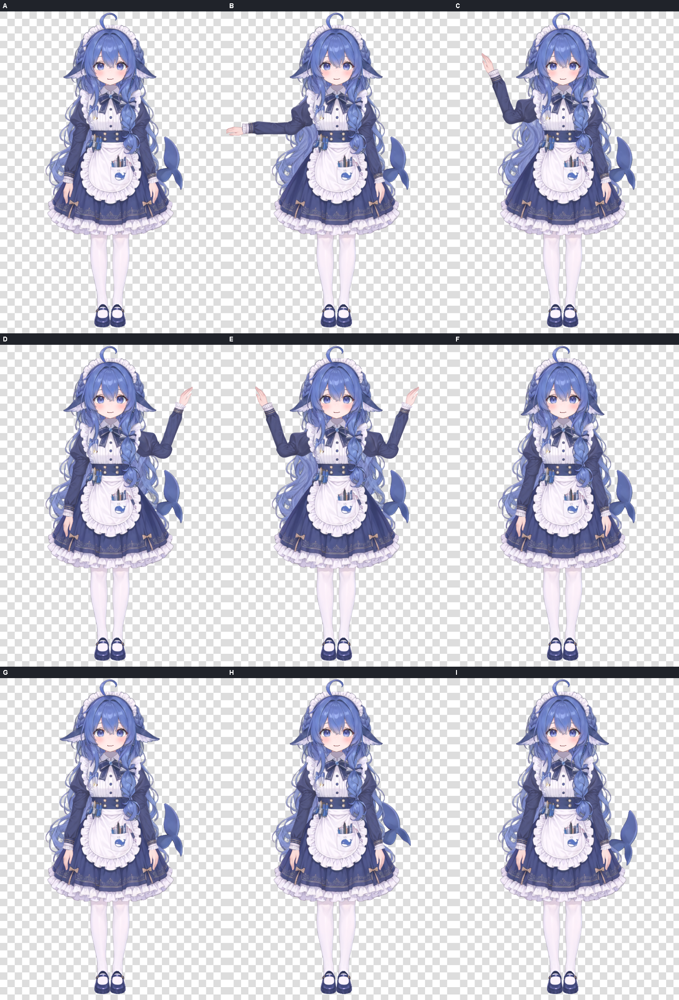

*模型制作阶段的姿态预览。A 为站立，B—E 展示手臂关节变化，F—G 展示耳朵变化，H—I 展示尾巴变化；聊天入口对应的是挥手、抖耳朵、摆尾巴三个动作，不是每格都对应独立指令。*

## 6. 放到桌面，并开启屏幕陪看

运行 `start.cmd` 启动桌宠。完成桌宠自己的角色、聊天与发声配置后，打开陪看面板或视觉设置。

1. 配置**支持图片输入**的视觉模型。文字聊天模型能正常回复，不代表它能识图。
2. 先使用“看一下屏幕”验证单次识图；根据系统提示选择屏幕或窗口并允许共享。
3. 需要持续陪伴时启用“持续陪看”。桌宠面板可选择屏幕或窗口，并提供“立即点评”和“停止陪看”。
4. 可使用有趣时点评模式；想验证点评链路，也可切换到“五秒必点评”模式。请求会持续消耗所选服务的额度。

<p align="center">
  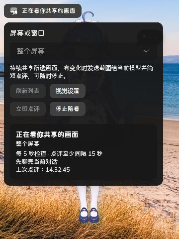
</p>

*桌面陪看的实际界面示例。截图展示的是早期陪看间隔，当前频率以应用所选模式为准。*

<p align="center">
  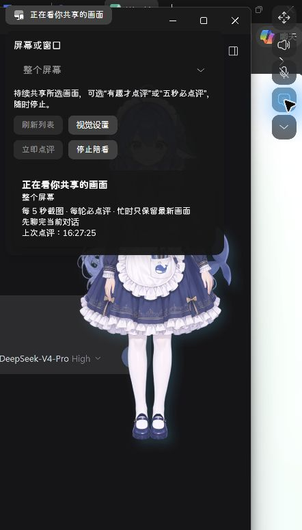
</p>

*切换“五秒必点评”后，面板会显示当前频率与状态。这个模式用于持续点评或测试；模型生成和语音播放仍需要时间，并不保证每五秒就能播完一句。“停止陪看”可立即结束采集。*

屏幕陪看的实现是定时截图并交给视觉服务分析，不是实时视频理解。角色设定会引导她简短点评，避免逐字念页面。**共享区域的画面会发送给你配置的服务**，请避开密码和私人内容；结束时点击“停止陪看”或停止共享。

## 常见问题

| 现象 | 检查方式 |
| --- | --- |
| 又出现欢迎页或默认角色 | 确认是否换了浏览器或桌宠；在当前环境导入角色并配置服务 |
| 有文字但没有声音 | 检查发声开关、服务 URL、Voice，以及本地 TTS 服务是否启动 |
| 能识别文字但没有回复 | 检查自动发送是否开启，以及聊天模型和 API Key 是否有效 |
| 说话时嘴巴不动 | 确认使用本包模型和修改后的应用，且声音由应用内 TTS 播放 |
| 看屏幕只给出泛泛回复 | 确认识图模型支持图片，且实际选择并共享了屏幕或窗口 |
| 提示端口被占用 | 请 Agent 查明已有服务；不要强制结束其他项目进程 |
| 安装卡在下载阶段 | 检查 GitHub、依赖源和模型下载站点的网络连接，查看终端错误 |

关闭后再次使用，运行对应启动脚本即可。同一应用的数据保存在本地；不要删除 `.runtime/` 或浏览器站点数据，否则可能需要重新安装或配置。

## 项目文件与许可

| 路径 | 内容 |
| --- | --- |
| `AGENTS.md` | Agent 安装、首次配置和验收指引 |
| `scripts/` | 安装器、启动器、TTS 适配器和检查脚本 |
| `overlay/` | 相对固定 AIRI 版本的源码修改 |
| `upstream.json` | 上游版本和源码文件校验信息 |
| `assets/character.airi.zip` | 角色卡与可运行 Live2D 模型 |
| `assets/source/` | 可编辑的 PSD 与 Cubism 工程 |
| `docs/images/` | 本文使用的效果图与操作截图 |
| `.runtime/` | 安装后生成的依赖、构建结果与本机运行数据，不随包分发 |

本项目在 AIRI 基础上扩展大肥鱼模型、动作联动和陪看体验；角色展示、服务配置等基础能力来自 AIRI。可选声线方案使用 [GPT-SoVITS](https://github.com/RVC-Boss/GPT-SoVITS)。

代码许可见 [LICENSE](LICENSE)，第三方模型、Live2D SDK、角色美术和声线素材的许可范围见 [NOTICE.md](NOTICE.md)。开源代码许可不代表第三方素材可任意商用。

API Key、参考录音、聊天记录和浏览器配置不随包分发，也不要提交到仓库。
